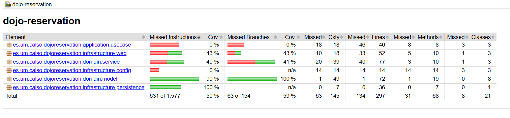
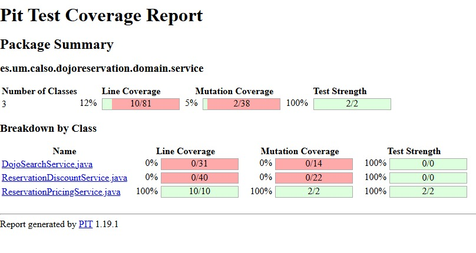

# Práctica 3. Diseño y ejecución de pruebas de software de caja blanca y de caja negra

**Asignatura:** Calidad del Software · Curso 2026–2027  
**Caso de estudio:** Dojo Reservation

## 1. Descripción general

El Ayuntamiento de una localidad gestiona la asignación de dojos para entrenamientos de equipos de cinco luchadores y el cálculo de su coste en la gestión de campeonatos de artes marciales. La aplicación está implementada en Java y dispone de dos páginas web: **búsqueda de dojos** y **cálculo del coste**.

El objetivo general es comprobar el comportamiento programado mediante técnicas de **caja blanca** (caminos independientes y cobertura de condiciones seleccionadas) y de **caja negra** (clases de equivalencia y análisis de valores límite), analizar resultados de calidad y justificar las correcciones de los defectos incluidos en las clases de estudio.

El documento [especificación funcional](docs/ESPECIFICACION.md) es la referencia para identificar los resultados esperados en el proceso de prueba; la [guía técnica y de pruebas](docs/GUIA_PRUEBAS.md) describe el uso de JUnit 5, Selenium y Maven.

## 2. Reparto y responsabilidades

Si la práctica es realizada por un único alumno deberá implementar el total de las pruebas de todos los ficheros propuestos para realizar las pruebas y deberá realizar la entrega completa de la práctica. En el caso de grupos formados por dos miembros se deberá seguir el siguiente reparto de responsabilidades:

| Integrante   | Caja blanca: métodos de dominio                                            | Caja negra: interfaz               |
| ------------ | -------------------------------------------------------------------------- | ---------------------------------- |
| **Alumno 1** | `containsAllRequiredWeapons` y `DojoSearchService.findFirstAvailableDojo`  | Búsqueda de dojos (`/dojos`)       |
| **Alumno 2** | `ReservationDiscountService.findYoungestFighter` y `calculateBestDiscount` | Costes y bonificaciones (`/coste`) |

Cada estudiante es responsable del **diseño, implementación, ejecución, análisis y corrección** de su parte. Ambos deben comprender la integración final, revisar las aportaciones del compañero y garantizar una regresión conjunta.

## 3. Actividad 1 · Pruebas de caja blanca

Las pruebas de caja blanca integran **dos técnicas en un mismo proceso**: diseño de caminos independientes y cobertura de condiciones. Estas pruebas deben completarse íntegramente antes de iniciar las pruebas de caja negra.
### Diseño de caminos independientes

Para cada uno de los dos métodos asignados a cada participante (todos los métodos para los grupos de un único participante) se realizarán los siguinetes pasos:

1. Construir el grafo de flujo con nodos, aristas, decisiones, bucles, retornos y excepciones relevantes.
2. Calcular, mediante las tres fórmulas vistas en clase de teoría, la complejidad ciclomática.
3. Identificar una base de caminos independientes y estudiar su factibilidad, justificando los recorridos imposibles.
4. Proponer los datos concretos, fechas y resultados esperados según la especificación, asociándolos a cada camino.

### Diseño de cobertura de condiciones

Después de la fase anterior y **antes de implementar los tests**, cada integrante analizará una decisión compuesta asignada (para los grupos formados por un único participante se analizarán las dos condiciones):

| Integrante | Método                                           | Decisión cuyo conjunto de condiciones se debe cubrir                                                                        |
| ---------- | ------------------------------------------------ | --------------------------------------------------------------------------------------------------------------------------- |
| Alumno 1   | `DojoSearchService.findFirstAvailableDojo`       | La decisión del bucle de reservas que combina con `&&` la igualdad del identificador de dojo y de la fecha de entrenamiento |
| Alumno 2   | `ReservationDiscountService.findYoungestFighter` | La decisión que combina con `\|\|` la comprobación `youngest == null` y la comparación de las fechas de nacimiento          |

Se identificarán las condiciones atómicas y los resultados verdadero y falso **efectivamente evaluados** en los casos ya propuestos para caminos independientes. Se tendrán en cuenta las reglas de cortocircuito de Java: una condición no evaluada no cuenta como falsa. Si faltan evaluaciones factibles, se propondrán **solo las pruebas necesarias** para cubrirlas, con sus entradas, fechas y resultados funcionales esperados. Las evaluaciones no factibles deberán justificarse. No se exige cobertura de condiciones de otras decisiones.

### Implementación y análisis de la caja blanca

Una vez completo el diseño de ambas técnicas, implementar los casos JUnit 5: un escenario y un resultado funcional principal por método de prueba, reutilizando casos cuando satisfagan ambos criterios. Ejecutar los tests, estudiar los fallos, justificar y realizar las correcciones y repetir la regresión.

Documentar por separado la **trazabilidad camino → prueba** y la **trazabilidad condición atómica/valor → prueba**.


## 4. Actividad 2 · Caja negra con Selenium

Cada integrante estudiará **su pantalla** mediante (para los grupos formados por un único participante se estudiarán las dos pantallas):

1. Identificación **previa** de las clases de equivalencia válidas e inválidas para las entradas y estados relevantes.
2. Identificación de los límites funcionales y selección de valores **antes / en / después** cuando resulte aplicable.
3. Tabla de diseño que indique **clase o límite, estado previo, entradas concretas, salida esperada y prueba**.
4. Implementación de los escenarios mediante los **archivos Selenium suministrados**. Las clases de apoyo ya incluyen navegación, ChromeDriver, espera y envío de formularios; no debéis construir esa infraestructura.
5. Ejecución en el navegador y contraste de resultados con la especificación.

Los desplegables solamente ofrecen identificadores conocidos; para comprobar un identificador inexistente podéis **abrir una URL con parámetros de petición** y verificar la respuesta de la aplicación. Esto comprueba la validación del servidor; no significa que el desplegable acepte tal entrada.

La ejecución E2E utiliza una **fecha del sistema controlada** (véase guía técnica) para que las pruebas de fechas sean repetibles.

## 5. Actividad 3 · Calidad, defectos y regresión

Una vez ejecutadas las pruebas diseñadas:

- **JaCoCo:** ejecutar el análisis local de cobertura de líneas y ramas, especialmente en los métodos objeto de prueba; explicar qué decisiones permanecen sin ejecutar.
- **GitHub Actions:** ejecutar las pruebas unitarias JUnit y publicar como artefactos sus resultados y los informes JaCoCo y PIT de los servicios de dominio. El diseño, la ejecución y el análisis de pruebas se realizan en Eclipse, sin depender de servidores de análisis externos.
- **PIT:** ejecutar localmente y explicar el análisis de mutación **sobre las pruebas unitarias de los métodos de dominio**, no sobre Selenium. Distinguir mutaciones detectadas, supervivientes y no cubiertas; no confundir la cobertura de código con la efectividad de los tests.
- **Regresión final:** repetir todas las pruebas después de cada corrección e identificar qué cambió y por qué.

No se permite eliminar tests, cambiar resultados esperados para hacerlos coincidir con defectos o desactivar controles para obtener una ejecución verde.

## 6. Entregables

El repositorio de la pareja contendrá la carpeta **`P3/`** con `README_P3.md`, el módulo Java Maven y los documentos/evidencias necesarios. El README de resolución incluirá:

| Apartado | Evidencias requeridas |
|---|---|
| Identificación | Nombre y apellidos de los dos integrantes, responsabilidades y ramas utilizadas |
| Caja blanca | Grafos, complejidad ciclomática, caminos independientes y su factibilidad; cobertura de condiciones seleccionadas, casos y resultados JUnit |
| Caja negra | Clases de equivalencia **antes** de los casos, límites, tablas de casos y resultados E2E |
| Defectos y correcciones | Síntoma, prueba que lo detectó, causa, corrección y regresión posterior |
| Herramientas de calidad | Informes locales de JaCoCo y PIT, resultados de JUnit y evidencias de GitHub Actions; interpretación de los resultados |
| Ejecución | Comandos usados, número de pruebas superadas y problemas de compatibilidad resueltos |
| Vídeo de síntesis | Enlace directo al vídeo externo, participación y explicación de un resultado concreto por integrante |


### Vídeo de síntesis de la práctica (entrega obligatoria)

Cada grupo presentará un **vídeo de síntesis de duración máxima de 7 minutos** (duración orientativa: 6–7 minutos), publicado en un servicio externo como YouTube en modo oculto/no listado. Se incorporará el enlace directo en \`P3/README_P3.md\`; **no se almacenará el vídeo en el repositorio**.

Participarán ambos integrantes (el participante si el grupo es unitario). Cada uno explicará un **resultado concreto** de sus pruebas o de sus análisis, indicando qué evidencia se obtiene, cómo se interpreta y, si existe un defecto, qué corrección se ha propuesto o aplicado. No se solicita un recorrido exhaustivo por todas las pruebas ni por todos los informes.

El vídeo mostrará la aplicación o las herramientas en funcionamiento y la interacción del ratón. Cada sección será una grabación continua de **pantalla, interacción y voz capturadas simultáneamente**; no se admite grabar las acciones y añadir posteriormente una voz en off. Se permiten transiciones entre secciones. No es obligatorio mostrar la cámara web. Deben garantizarse texto legible, audio inteligible y ausencia de ruido de fondo que dificulte la evaluación. El README recogerá las partes concretas qué explica cada participante y el enlace a la grabación.


## 7. Criterios de calidad de las pruebas

- Utilizar nombres `testGiven<EntradasYEstadoConcretos>When<Accion>Then<SalidaConcreta>`.
- No agrupar varios escenarios en un solo método ni utilizar un bucle para probar muchos casos dentro de una única prueba.
- Colocar `@Test` en su propia línea y escribir cada instrucción Java en línea separada.
- Emplear fechas explícitas en las tablas; justificar excepciones y caminos no factibles.
- Mantener la separación entre **especificación**, **diseño del test**, **ejecución** y **análisis del defecto**.
- Conservar la infraestructura preparada, las interfaces públicas y los selectores estables de las pantallas.

## 8. Material y soporte

- [Especificación funcional](docs/ESPECIFICACION.md).
- [Diagramas de arquitectura y UML del dominio](docs/DIAGRAMAS.md).
- [Guía técnica JUnit, Selenium, Maven y tablas de pruebas](docs/GUIA_PRUEBAS.md).
- [Compatibilidad de versiones y resolución de incidencias](docs/ENTORNO_Y_VERSIONES.md).
- Los informes de cobertura y mutaciones se obtienen con Maven; GitHub Actions permite comprobar la regresión y consultar sus artefactos.
- [Plantilla del workflow GitHub Actions para cada grupo](dos/GUIA_PRUEBAS.md#plantilla-de-github-actions-para-el-repositorio-del-grupo).

Las fechas de entrega y cualquier instrucción institucional adicional se comunicarán mediante el Aula Virtual


## Resolución del grupo

### Identificación
* **Integrante 1 (Javier Sánchez Dólera):** Caja blanca (`containsAllRequiredWeapons`, `findFirstAvailableDojo`) y Caja negra (Búsqueda `/dojos`). Rama: `feature/p3-javier-busqueda`
* **Integrante 2 (Diego Sánchez Cano):** Caja blanca (`findYoungestFighter`, `calculateBestDiscount`) y Caja negra (Costes `/coste`). Rama: `feature/p3-diego-costes`

---

### Actividad 1: Caja Blanca

#### Método 1: `containsAllRequiredWeapons`
**1. Grafo de flujo y Complejidad Ciclomática**
* **Nodos (N):** 8
* **Aristas (A):** 8
* **Nodos de Salida (S):** 4 (dos `throw` y dos `return`)
* **Nodos Predicado (P):** 4 (tres `if` y un `for`)

Cálculo mediante las fórmulas:
1. **CC = A - N + S + 1** = 8 - 8 + 4 + 1 = **5**
2. **CC = P + 1** = 4 + 1 = **5**
*(Complejidad Ciclomática = 5. Identificamos 5 caminos base)*

**2. Caminos independientes y datos de prueba**

| Método                       | Nodo o camino identificado | Datos de entrada y fecha                          | Resultado esperado según especificación | Nombre del test                                                                      | Resultado ejecución                          |
| ---------------------------- | -------------------------- | ------------------------------------------------- | --------------------------------------- | ------------------------------------------------------------------------------------ | -------------------------------------------- |
| `containsAllRequiredWeapons` | C1: 1->2                   | `available = null`, `required = {Cualquier}`      | Lanza `NullPointerException`            | `testGivenAvailableWeaponsNullWhenCheckingContainsAllThenThrowsNullPointerException` | Superado                                     |
| `containsAllRequiredWeapons` | C2: 1->3->4                | `available = {}`, `required = null`               | Lanza `NullPointerException`            | `testGivenRequiredWeaponsNullWhenCheckingContainsAllThenThrowsNullPointerException`  | Superado                                     |
| `containsAllRequiredWeapons` | C3: 1->3->5->8             | `available = {Katana}`, `required = {}`           | Devuelve `true`                         | `testGivenEmptyRequiredWeaponsWhenCheckingContainsAllThenReturnsTrue`                | Superado                                     |
| `containsAllRequiredWeapons` | C4: 1->3->5->6->7          | `available = {}`, `required = {Katana}`           | Devuelve `false`                        | `testGivenMissingRequiredWeaponWhenCheckingContainsAllThenReturnsFalse`              | Falla inicialmente, superado tras corrección |
| `containsAllRequiredWeapons` | C5: 1->3->5->6->5->8       | `available = {Katana}`, `required = {Katana, Bo}` | Devuelve `false`                        | `testGivenAvailableKatanaAndMissingBoWhenCheckingContainsAllThenReturnsFalse`        | Falla inicialmente y superado tras correción |

#### Método 2: `findFirstAvailableDojo`
**1. Grafo de flujo y Complejidad Ciclomática**
* **Nodos (N):** 18
* **Aristas (A):** 21
* **Nodos de Salida (S):** 6 (cuatro `throw` y dos `return`)
* **Nodos Predicado (P):** 9 (cuatro `if` iniciales, dos `for`, un `if` de armas, un `if` de reservas y un `if` final)

Cálculo mediante las fórmulas:
1. **CC = A - N + S + 1** = 21 - 18 + 6 + 1 = **10**
2. **CC = P + 1** = 9 + 1 = **10**
*(Complejidad Ciclomática = 10. Identificamos 10 caminos base).*

**2. Caminos independientes y datos de prueba**

| Método                   | Nodo o camino identificado        | Datos de entrada y fecha                | Resultado esperado según especificación | Nombre del test                                                                      | Resultado ejecución                          |
| ------------------------ | --------------------------------- | --------------------------------------- | --------------------------------------- | ------------------------------------------------------------------------------------ | -------------------------------------------- |
| `findFirstAvailableDojo` | C1: Excepción dojos null          | `dojos = null`                          | Lanza `NullPointerException`            | `testGivenNullDojosWhenFindFirstAvailableThenThrowsNullPointerException`             | Superado                                     |
| `findFirstAvailableDojo` | C2: Excepción armas null          | `dojos = [], requiredWeapons = null`    | Lanza `NullPointerException`            | `testGivenNullRequiredWeaponsWhenFindFirstAvailableThenThrowsNullPointerException`   | Superado                                     |
| `findFirstAvailableDojo` | C3: Excepción reservas null       | `reservations = null`                   | Lanza `NullPointerException`            | `testGivenNullReservationsWhenFindFirstAvailableThenThrowsNullPointerException`      | Superado                                     |
| `findFirstAvailableDojo` | C4: Excepción fecha null          | `trainingDate = null`                   | Lanza `NullPointerException`            | `testGivenNullTrainingDateWhenFindFirstAvailableThenThrowsNullPointerException`      | Superado                                     |
| `findFirstAvailableDojo` | C5: Lista dojos vacía             | `dojos = []`                            | Devuelve `Optional.empty()`             | `testGivenEmptyDojoListWhenFindFirstAvailableThenReturnsEmpty`                       | Superado                                     |
| `findFirstAvailableDojo` | C6: Dojo sin armas                | Dojo 1 sin armas requeridas             | Devuelve `Optional.empty()`             | `testGivenDojoWithoutRequiredWeaponsWhenFindFirstAvailableThenReturnsEmpty`          | Superado                                     |
| `findFirstAvailableDojo` | C7: Dojo con armas, sin reservas  | Dojo 1 con armas, `reservations = []`   | Devuelve `Optional.of(dojo1)`           | `testGivenAvailableDojoWithoutReservationsWhenFindFirstAvailableThenReturnsDojo`     | Superado                                     |
| `findFirstAvailableDojo` | C8: Reserva distinta (ID o Fecha) | Dojo 1, Reserva Dojo 2 o fecha distinta | Devuelve `Optional.of(dojo1)`           | `testGivenDojoWithReservationOnDifferentDateWhenFindFirstAvailableThenReturnsDojo`   | Superado                                     |
| `findFirstAvailableDojo` | C9: Reserva coincide (Ocupado)    | Dojo 1, Reserva Dojo 1, MISMA fecha     | Devuelve `Optional.empty()`             | `testGivenDojoWithReservationOnSameDateWhenFindFirstAvailableThenReturnsEmpty`       | Falla inicialmente, superado tras corrección |
| findFirstAvailableDojo   | C10: Siguiente iteración bucle    | Dojo 1, Ocupado<br>Dojo 2, Libre        | Devuelve `Optional.of(dojo2)`           | `testGivenFirstDojoOccupiedAndSecondFreeWhenFindFirstAvailableThenReturnsSecondDojo` | Falla inicialmente, superado tras corrección |

#### Cobertura de Condiciones (Método 2: Bucle de reservas)

| Condicion atomica                                  | Caso que evalua verdadero                                         | Caso que evalua falso                             | Casos adicionales | Justificacion si no es factible |
| -------------------------------------------------- | ----------------------------------------------------------------- | ------------------------------------------------- | ----------------- | ------------------------------- |
| `reservation.dojoId().equals(dojo.id())`           | C9: Ocupado (Reserva mismo ID dojo y misma fecha)                 | C8a: Reserva distinta (Reserva diferente ID dojo) | Ninguno           | N/A                             |
| `!reservation.trainingDate().equals(trainingDate)` | C8b: Reserva distinta (Reserva mismo ID dojo pero distinta fecha) | C9: Ocupado (Reserva mismo ID dojo y misma fecha) | Ninguno           | N/A                             |
Como prueba complementaria, se añadió `testGivenReservationForDifferentDojoOnSameDateWhenFindFirstAvailableThenReturnsDojo`, que comprueba que la primera condición es falsa y que, debido al cortocircuito de `&&`, la segunda no llega a evaluarse
#### Método 3: `findYoungestFighter`

**Cálculo mediante las tres fórmulas:**

| Fórmula | Sustitución | Resultado |
|---|---|---:|
| V(G) = A - N + 2 | 20 - 15 + 2 | **7** |
| V(G) = P + 1 | 6 + 1 | **7** |
| V(G) = R | 7 | **7** |

**Complejidad ciclomática: V(G) = 7 (7 caminos independientes).**

**1. Grafo de flujo y Complejidad Ciclomática**
* **Nodos (N):** 15
* **Aristas (A):** 20
* **Nodos Predicado:** 6
* **Complejidad Ciclomática:** CC = Nodos Predicado + 1 = 7.

**Base de caminos independientes **

| Camino | Secuencia de nodos                                                                                         | Situación que representa        |
| ------ | ---------------------------------------------------------------------------------------------------------- | ------------------------------- |
| C1     | 1 → 2(V) → 3 → 15                                                                                          | Lista de luchadores nula        |
| C2     | 1 → 2(F) → 4(V) → 5 → 15                                                                                   | Fecha de referencia nula        |
| C3     | 1 → 2(F) → 4(F) → 6 → 7(F) → 14 → 15                                                                       | Lista vacía                     |
| C4     | 1 → 2(F) → 4(F) → 6 → 7(V) → 8 → 9(V) → 10 → 15                                                            | Luchador nulo                   |
| C5     | 1 → 2(F) → 4(F) → 6 → 7(V) → 8 → 9(F) → 11(V) → 13 → 7(F) → 14 → 15                                        | Un único luchador válido        |
| C6     | 1 → 2(F) → 4(F) → 6 → 7(V) → 8 → 9(F) → 11(V) → 13 → 7(V) → 8 → 9(F) → 11(F) → 12(F) → 7(F) → 14 → 15      | Segundo luchador nacido antes   |
| C7     | 1 → 2(F) → 4(F) → 6 → 7(V) → 8 → 9(F) → 11(V) → 13 → 7(V) → 8 → 9(F) → 11(F) → 12(V) → 13 → 7(F) → 14 → 15 | Segundo luchador nacido después |


**2. Caminos independientes y datos de prueba**

| Método                | Nodo o camino identificado          | Datos de entrada y fecha                                                                           | Resultado esperado según especificación                               | Nombre del test                                                                      | Resultado ejecución                             |
| --------------------- | ----------------------------------- | -------------------------------------------------------------------------------------------------- | --------------------------------------------------------------------- | ------------------------------------------------------------------------------------ | ----------------------------------------------- |
| `findYoungestFighter` | C1: Excepción lista nula            | `fighters = null`, `referenceDate = 2026-10-20`                                                    | Lanza `NullPointerException("Fighters are required")`                 | `testGivenNullFightersWhenFindYoungestFighterThenThrowsFightersAreRequired`          | Superado                                        |
| `findYoungestFighter` | C2: Excepción fecha nula            | `fighters = []`, `referenceDate = null`                                                            | Lanza `NullPointerException("Reference date is required")`            | `testGivenNullReferenceDateWhenFindYoungestFighterThenThrowsReferenceDateIsRequired` | Superado                                        |
| `findYoungestFighter` | C3: Lista vacía                     | `fighters = []`, `referenceDate = 2026-10-20`                                                      | Devuelve `Optional.empty()`                                           | `testGivenEmptyFightersWhenFindYoungestFighterThenReturnsEmpty`                      | Superado                                        |
| `findYoungestFighter` | C4: Luchador nulo                   | `fighters = [null]`, `referenceDate = 2026-10-20`                                                  | Lanza `NullPointerException("Null fighter")`                          | `testGivenNullFighterWhenFindYoungestFighterThenThrowsNullFighter`                   | Superado                                        |
| `findYoungestFighter` | C5: Un único luchador               | Un luchador nacido el `2000-05-10`, `referenceDate = 2026-10-20`                                   | Devuelve el único luchador de la lista                                | `testGivenOneFighterWhenFindYoungestFighterThenReturnsThatFighter`                   | Superado                                        |
| `findYoungestFighter` | C6: Segundo luchador nacido antes   | Luchador 1 nacido el `2000-05-10`; luchador 2 nacido el `1999-02-20`. `referenceDate = 2026-10-20` | Devuelve el luchador 1, por tener la fecha de nacimiento más reciente | `testGivenSecondFighterBornEarlierWhenFindYoungestFighterThenReturnsFirstFighter`    | Falló inicialmente; superado tras la corrección |
| `findYoungestFighter` | C7: Segundo luchador nacido después | Luchador 1 nacido el `2000-05-10`; luchador 2 nacido el `2005-02-20`. `referenceDate = 2026-10-20` | Devuelve el luchador 2, por tener la fecha de nacimiento más reciente | `testGivenSecondFighterBornLaterWhenFindYoungestFighterThenReturnsSecondFighter`     | Falló inicialmente; superado tras la corrección |

**Prueba complementaria: empate en la fecha de nacimiento**

Esta prueba comprueba la regla de desempate establecida en la especificación: cuando dos luchadores tienen la misma fecha de nacimiento, se debe conservar el primero de la lista. Sigue el mismo recorrido que C7: la condición `youngest == null` es falsa y la comparación de las fechas también resulta falsa.

| Método                | Situación                                       | Datos de entrada y fecha                                                                                 | Resultado esperado según especificación  | Nombre del test                                                                       | Resultado ejecución |
| --------------------- | ----------------------------------------------- | -------------------------------------------------------------------------------------------------------- | ---------------------------------------- | ------------------------------------------------------------------------------------- | ------------------- |
| `findYoungestFighter` | Dos luchadores con la misma fecha de nacimiento | Luchador 1 nacido el `2005-02-20`; luchador 2 nacido el `2005-02-20`. Fecha de referencia: `2026-10-20`. | Devuelve el primer luchador de la lista. | `testGivenTwoFightersWithSameBirthDateWhenFindYoungestFighterThenReturnsFirstFighter` | Superado            |

#### Método 4: calculateBestDiscount

**Cálculo mediante las tres fórmulas:**

| Fórmula | Sustitución | Resultado |
|---|---|---:|
| V(G) = A - N + 2 | 37 - 27 + 2 | **12** |
| V(G) = P + 1 | 11 + 1 | **12** |
| V(G) = R | 12 | **12** |

**Complejidad ciclomática: V(G) = 12 (12 caminos independientes estructurales).**

**1. Grafo de flujo y Complejidad Ciclomática**
* **Nodos (N):** 27
* **Aristas (A):** 37
* **Nodos Predicado:** 11
* **Complejidad Ciclomática:** CC = Nodos Predicado + 1 = 12.

**Base de caminos independientes**

| Camino | Secuencia de nodos                                                                                                                                                                                   | Situación que representa                                                        |
| ------ | ---------------------------------------------------------------------------------------------------------------------------------------------------------------------------------------------------- | ------------------------------------------------------------------------------- |
| C1     | 1 → 2(V) → 3 → 27                                                                                                                                                                                    | Lista de luchadores nula                                                        |
| C2     | 1 → 2(F) → 4(V) → 5 → 27                                                                                                                                                                             | Fecha de entrenamiento nula                                                     |
| C3     | 1 → 2(F) → 4(F) → 6 → 7(F) → 11(F) → 26 → 27                                                                                                                                                         | Lista vacía                                                                     |
| C4     | 1 → 2(F) → 4(F) → 6 → 7(V) → 8 → 9(F) → 11(V) → 12 → 13(F) → 15 → 16(F) → 11(F) → 26 → 27                                                                                                            | Luchador adulto sin desempleo                                                   |
| C5     | 1 → 2(F) → 4(F) → 6 → 7(V) → 8 → 9(V) → 10 → 11(V) → 12 → 13(F) → 15 → 16(F) → 11(F) → 26 → 27                                                                                                       | Luchador menor de 18 años sin desempleo                                         |
| C6     | 1 → 2(F) → 4(F) → 6 → 7(V) → 8 → 9(F) → 11(V) → 12 → 13(V) → 14 → 27<br>                                                                                                                             | Rama `fighter == null` del segundo bucle                                        |
| C7     | 1 → 2(F) → 4(F) → 6 → 7(V) → 8 → 9(F) → 11(V) → 12 → 13(F) → 15 → 16(V) → 17 → 18(V) → 19 → 24(V) → 25 → 11(F) → 26 → 27                                                                             | Desempleo de 3 años completos o más                                             |
| C8     | 1 → 2(F) → 4(F) → 6 → 7(V) → 8 → 9(F) → 11(V) → 12 → 13(F) → 15 → 16(V) → 17 → 18(F) → 20(V) → 21 → 24(V) → 25 → 11(F) → 26 → 27                                                                     | Rama `completeYears > 2` verdadera                                              |
| C9     | 1 → 2(F) → 4(F) → 6 → 7(V) → 8 → 9(F) → 11(V) → 12 → 13(F) → 15 → 16(V) → 17 → 18(F) → 20(F) → 22(V) → 23 → 24(V) → 25 → 11(F) → 26 → 27                                                             | Desempleo de exactamente 2 años completos                                       |
| C10    | 1 → 2(F) → 4(F) → 6 → 7(V) → 8 → 9(F) → 11(V) → 12 → 13(F) → 15 → 16(V) → 17 → 18(F) → 20(F) → 22(F) → 24(F) → 11(F) → 26 → 27                                                                       | Desempleo inferior a 1 año completo                                             |
| C11    | 1 → 2(F) → 4(F) → 6 → 7(V) → 8 → 9(V) → 10 → 11(V) → 12 → 13(F) → 15 → 16(V) → 17 → 18(F) → 20(F) → 22(V) → 23 → 24(F) → 11(F) → 26 → 27                                                             | Luchador menor de 18 años con un año completo de desempleo                      |
| C12    | 1 → 2(F) → 4(F) → 6 → 7(V) → 8 → 9(F) → 11(V) → 12 → 13(F) → 15 → 16(V) → 17 → 18(V) → 19 → 24(V) → 25 → 11(V) → 12 → 13(F) → 15 → 16(V) → 17 → 18(F) → 20(F) → 22(V) → 23 → 24(F) → 11(F) → 26 → 27 | Dos luchadores con diferentes períodos de desempleo y dos iteraciones del bucle |

**2. Caminos independientes y datos de prueba**

| Método                  | Nodo o camino identificado                                | Datos de entrada y fecha                                                                                                                                                 | Resultado esperado según especificación                    | Nombre del test                                                                                                  | Resultado ejecución                     |
| ----------------------- | --------------------------------------------------------- | ------------------------------------------------------------------------------------------------------------------------------------------------------------------------ | ---------------------------------------------------------- | ---------------------------------------------------------------------------------------------------------------- | --------------------------------------- |
| `calculateBestDiscount` | C1: Excepción lista nula                                  | `fighters = null`, `trainingDate = 2026-10-20`                                                                                                                           | Lanza `NullPointerException("Fighters are required")`      | `testGivenNullFightersWhenCalculateBestDiscountThenThrowsFightersAreRequired`                                    | ```Superado ```                         |
| `calculateBestDiscount` | C2: Excepción fecha nula                                  | `fighters = []`, `trainingDate = null`                                                                                                                                   | Lanza `NullPointerException("Training date is required")`  | `testGivenNullTrainingDateWhenCalculateBestDiscountThenThrowsTrainingDateIsRequired`                             | ```Superado ```                         |
| `calculateBestDiscount` | C3: Lista vacía                                           | `fighters = []`, `trainingDate = 2026-10-20`                                                                                                                             | Devuelve `Discount(0)`                                     | `testGivenEmptyFightersWhenCalculateBestDiscountThenReturnsZeroDiscount`                                         | ```Superado ```                         |
| `calculateBestDiscount` | C4: Luchador adulto sin desempleo                         | Un luchador nacido el `2000-05-10`, sin período de desempleo. Fecha `2026-10-20`                                                                                         | Devuelve `Discount(0)`                                     | `testGivenAdultFighterWithoutUnemploymentWhenCalculateBestDiscountThenReturnsZeroDiscount`                       | ```Superado ```                         |
| `calculateBestDiscount` | C5: Luchador menor de 18 años                             | Un luchador nacido el `2009-05-10`, sin período de desempleo. Fecha `2026-10-20`                                                                                         | Devuelve `Discount(15)`                                    | `testGivenYoungFighterWithoutUnemploymentWhenCalculateBestDiscountThenReturnsFifteenPercent`                     | ```Superado ```                         |
| `calculateBestDiscount` | C6: Luchador nulo en el segundo bucle                     | Ninguna entrada coherente puede alcanzar esta rama                                                                                                                       | No factible                                                | N/A                                                                                                              | ```N/A ```                              |
| `calculateBestDiscount` | C7: Desempleo de 3 años completos                         | Un luchador adulto nacido el `1990-05-10`, con desempleo iniciado el `2023-10-20`. Fecha `2026-10-20`                                                                    | Devuelve `Discount(30)`                                    | `testGivenThreeCompleteYearsOfUnemploymentWhenCalculateBestDiscountThenReturnsThirtyPercent`                     | ```Superado ```                         |
| `calculateBestDiscount` | C8: Condición `completeYears > 2` verdadera (no factible) | No existe ningún valor entero que cumpla `completeYears >= 3` falso y `completeYears > 2` verdadero                                                                      | Camino no factible, pasa a ser factible                    | N/A pasa a Discount(20)                                                                                          | ```Superado ```                         |
| `calculateBestDiscount` | C9: Exactamente 1 años completos de desempleo             | Un luchador adulto nacido el `1990-05-10`, con desempleo iniciado el `2024-10-20`. Fecha `2026-10-20`                                                                    | Devuelve `Discount(20)`                                    | `testGivenTwoCompleteYearsOfUnemploymentWhenCalculateBestDiscountThenReturnsTwentyPercent`                       | ```Primero fallo y luego se supero. ``` |
| `calculateBestDiscount` | C10: Desempleo inferior a 1 año completo                  | Un luchador adulto nacido el `1990-05-10`, con desempleo iniciado el `2025-10-21`. Fecha `2026-10-20`                                                                    | Devuelve `Discount(0)`                                     | `testGivenLessThanOneCompleteYearOfUnemploymentWhenCalculateBestDiscountThenReturnsZeroDiscount`                 | ```Superado ```                         |
| `calculateBestDiscount` | C11: Bonificación por desempleo inferior a la de juventud | Un luchador nacido el `2009-05-10`, con desempleo iniciado el `2025-05-10`. Fecha `2026-10-20`                                                                           | Devuelve `Discount(15)`, conservando la mayor bonificación | `testGivenYoungFighterWithOneCompleteYearOfUnemploymentWhenCalculateBestDiscountThenKeepsYouthDiscount`          | ```Superado ```                         |
| `calculateBestDiscount` | C12: Dos luchadores con distintos períodos de desempleo   | Luchador 1 adulto, nacido el `1990-05-10`, desempleado desde `2023-10-20`; luchador 2 adulto, nacido el `1995-05-10`, desempleado desde `2025-10-20`. Fecha `2026-10-20` | Devuelve `Discount(30)`, sin sumar las bonificaciones      | `testGivenFightersWithThirtyAndTenPercentUnemploymentDiscountsWhenCalculateBestDiscountThenReturnsThirtyPercent` | ```Superado ```                         |

**Comportamiento excepcional complementario**

Aunque la rama `fighter == null` del segundo bucle es inalcanzable con una lista estable, el contrato del método establece que una lista que contiene un luchador nulo provoca `NullPointerException("Null fighter")`. Se añade una prueba específica para comprobar este comportamiento. La excepción se produce durante la llamada previa a `findYoungestFighter`, por lo que esta prueba no cubre la rama inalcanzable del segundo bucle.

| Método | Situación | Datos de entrada y fecha | Resultado esperado según especificación | Nombre del test | Resultado ejecución |
|---|---|---|---|---|---|
| `calculateBestDiscount` | Lista que contiene un luchador nulo | `fighters = [null]`, `trainingDate = 2026-10-20` | Lanza `NullPointerException("Null fighter")`, propagada desde `findYoungestFighter`. | `testGivenListContainingNullFighterWhenCalculateBestDiscountThenThrowsNullFighter` | Pendiente |

#### Cobertura de Condiciones (Método 3: `findYoungestFighter`)

Se analiza la decisión compuesta del método `findYoungestFighter`:

`youngest == null || fighter.birthDate().isBefore(youngest.birthDate())`

La decisión contiene dos condiciones atómicas:

- **A:** `youngest == null`.
- **B:** `fighter.birthDate().isBefore(youngest.birthDate())`.

| Condición atómica                                   | Caso que evalúa verdadero         | Caso que evalúa falso               | Casos adicionales | Justificación si no es factible                         |
| --------------------------------------------------- | --------------------------------- | ----------------------------------- | ----------------- | ------------------------------------------------------- |
| `youngest == null`                                  | C5: Primer luchador de la lista   | C6 y C7: Segundo luchador           | Ninguno           | N/A                                                     |
| `fighter.birthDate().isAfter(youngest.birthDate())` | C6: Segundo luchador nacido antes | C7: Segundo luchador nacido después | Ninguno           | En C5 no se evalúa debido al cortocircuito del operador |
|                                                     |                                   |                                     |                   |                                                         |

---

### Actividad 2: Caja Negra (Búsqueda /dojos)
*(Tablas de clases de equivalencia y valores límite pendientes)*

### Actividad 2: Caja Negra (Búsqueda /dojos)

**1. Tabla de clases de equivalencia**

| Código de clase | Variable         | Condición de pertenencia                                                 | Válida / inválida | Comportamiento exigido                               |
| --------------- | ---------------- | ------------------------------------------------------------------------ | ----------------- | ---------------------------------------------------- |
| CE1             | `teamId`         | Identificador de un equipo existente (ej. EQ-001)                        | Válida            | Permite la búsqueda y muestra la tabla de dojos      |
| CE2             | `teamId`         | Identificador vacío o nulo                                               | Inválida          | Muestra error: `team id is required`                 |
| CE3             | `teamId`         | Identificador inexistente en el catálogo (ej EQ-999)                     | Inválida          | Muestra error: `team does not exist`                 |
| CE4             | `trainingDate`   | Fecha estrictamente posterior a la actual                                | Válida            | Permite la búsqueda y evalúa disponibilidad          |
| CE5             | `trainingDate`   | Fecha igual a la actual                                                  | Inválida          | Muestra error: `training date must be in the future` |
| CE6             | `trainingDate`   | Fecha anterior a la actual                                               | Inválida          | Muestra error: `training date must be in the future` |
| CE-T1           | Equipo           | Equipo existente sin bonificaciones EQ-002                               | Válida            | no hay descuento                                     |
| CE-T2           | Equipo           | Equipo con luchador menor de 18 años EQ-003                              | Válida            | Descuento juvenil del 15 %                           |
| CE-T3           | Equipo           | Equipo con desempleo inferior a un año completo : EQ-004                 | Válida            | Descuento por Desempleo del 0 %                      |
| CE-T4           | Equipo           | equipo con desempleo de 1 a menos de 2 años completos EQ-004             | Válida            | Descuento del 10 %                                   |
| CE-T5           | Equipo           | Equipo con desempleo de 2 a menos de 3 años completos EQ-004 o el EQ-005 | Válida            | Descuento del 20 %                                   |
| CE-T6           | Equipo           | Equipo con desempleo de 3 años completos o más: EQ-005                   | Válida            | Descuento del 30 %                                   |
| CE-T7           | Equipo           | Equipo en el que hayan bonificaciones juvenil y por desempleo EQ-001     | Válida            | Aplicar exclusivamente la mayor bonificación         |
| CE-T8           | `teamId`         | Identificador vacío                                                      | Inválida          | Mostrar Team id is required                          |
| CE-T9           | `teamId`         | Identificador inexistente                                                | Inválida          | Mostrar Team does not exist                          |
| CE-D1           | `dojoId`         | Identificador de un dojo existente                                       | Válida            | Utilizar el precio base.                             |
| CE-D2           | `dojoId`         | Identificador vacío                                                      | Inválida          | El id del dojo es necesario                          |
| CE-D3           | `dojoId`         | Identificador inexistente                                                | Inválida          | El dojo no existe                                    |
| CE-F1           | `trainingDate`   | Fecha anterior al reloj de aplicación                                    | Inválida          | Mostrar: La fecha debe ser futura                    |
| CE-F2           | `trainingDate`   | Fecha igual al reloj de aplicación                                       | Inválida          | Mostrar: La fecha debe ser futura                    |
| CE-F3           | `trainingDate`   | Fecha posterior al reloj de aplicación                                   | Válida            | Permitir calcular el coste                           |
| CE-A1           | Armas requeridas | Equipo que requiere una única arma distinta EQ-002                       | Válida            | Aplicar un suplemento de 5 €                         |
| CE-A2           | Armas requeridas | Equipo que requiere dos armas distintas EQ-001                           | Válida            | Aplicar un suplemento de 10 €                        |


**2. Casos de prueba**
 
| ID del caso | Clases cubiertas    | Equipo/dojo/fecha o URL concreta                            | Estado inicial                                     | Resultado único esperado                                                                             | Nombre prueba                                                                                       |
| ----------- | ------------------- | ----------------------------------------------------------- | -------------------------------------------------- | ---------------------------------------------------------------------------------------------------- | --------------------------------------------------------------------------------------------------- |
| CP1         | CE1, CE4            | `teamId` = EQ-001, `trainingDate` = 2026-10-21              | Catálogo intacto (D-001 tiene reservas)            | Muestra `#dojo-table` resaltando el primer dojo libre y compatible con las armas                     | `testGivenValidTeamAndFutureDateWhenSearchThenShowsAvailableDojo`                                   |
| CP2         | CE2, CE4            | `teamId` = (vacío), `trainingDate` = 2026-10-25             | N/A                                                | Muestra `#error` indicando `Team id is required`                                                     | `testGivenEmptyTeamWhenSearchThenShowsTeamRequiredError`                                            |
| CP3         | CE3, CE4            | `teamId` = EQ-999, `trainingDate` = 2026-10-25              | Navegación directa por URL o inyección             | Muestra `#error` indicando `Team does not exist`                                                     | `testGivenNonExistentTeamWhenSearchThenShowsTeamDoesNotExistError`                                  |
| CP4         | CE1, CE5            | `teamId` = EQ-001, `trainingDate` = 2026-10-20              | N/A                                                | Muestra `#error` indicando `Training date must be in the future`                                     | `testGivenTodayDateWhenSearchThenShowsDateMustBeFutureError`                                        |
| C01         | CE-T8               | `teamId=&dojoId=D-001&trainingDate=2026-10-21`              | Catálogo original                                  | Mostrar : necesita id del equipo                                                                     | `testGivenMissingTeamIdWhenCalculateCostThenShowsTeamIdRequired`                                    |
| C02         | CE-D2               | `/coste?teamId=EQ-002&dojoId=&trainingDate=2026-10-21`      | Catálogo original                                  | Mostrar: necesito dojo id                                                                            | `testGivenMissingDojoIdWhenCalculateCostThenShowsDojoIdRequired`                                    |
| C03         | CE-T9               | `/coste?teamId=EQ-999&dojoId=D-001&trainingDate=2026-10-21` | Catálogo original                                  | Mostrar: el equipo no existe                                                                         | `testGivenUnknownTeamIdWhenCalculateCostThenShowsTeamDoesNotExist`                                  |
| C04         | CE-D3               | `/coste?teamId=EQ-002&dojoId=D-999&trainingDate=2026-10-21` | Catálogo original                                  | Mostrar que el Dojo does not exist                                                                   | `testGivenUnknownDojoIdWhenCalculateCostThenShowsDojoDoesNotExist`                                  |
| C05         | CE-F1               | `EQ-002`, `D-003`, `2026-10-19`                             | Reloj de aplicación: 20/10/2026                    | Mostrar que la fecha debe ser futura                                                                 | `testGivenPastTrainingDateWhenCalculateCostThenShowsFutureDateRequired`                             |
| C06         | CE-F2               | `EQ-002`, `D-003`, `2026-10-20`                             | Reloj de aplicación: 20/10/2026                    | Mostrar: que la fecha debe ser futura                                                                | `testGivenTodayAsTrainingDateWhenCalculateCostThenShowsFutureDateRequired`                          |
| C07         | CE-T1, CE-A1, CE-F3 | `EQ-002`, `D-003`, `2026-10-21`                             | Catálogo original                                  | Precio base: 35,00 €; suplemento: 5,00 €; subtotal: 40,00 €; descuento: 0 %; precio final: 40,00 €   | `testGivenTomorrowTrainingDateWithRegularTeamAndDojoSurWhenCalculateCostThenCalculatesPrices`       |
| C08         | CE-T7, CE-A2, CE-F3 | `EQ-001`, `D-001`, `2026-11-20`                             | D-001 tiene una reserva para esa fecha             | Precio base: 40,00 €; suplemento: 10,00 €; subtotal: 50,00 €; descuento: 20 %; precio final: 40,00 € | `testGivenReservedDojoDateWhenCalculateCostThenStillCalculatesCost`                                 |
| C09         | CE-T7, CE-A2, CE-F3 | `EQ-001`, `D-002`, `2026-10-21`                             | Catálogo original                                  | Precio base: 50,00 €; suplemento: 10,00 €; subtotal: 60,00 €; descuento: 15 %; precio final: 51,00 € | `testGivenTwoRequiredWeaponsAndCompetingDiscountsWhenCalculateCostThenAppliesOnlyHighestDiscount`   |
| C10         | CE-T2               | `EQ-003`, `D-003`, `2027-11-19`                             | Luchador más joven con 17 años                     | Precio base: 35,00 €; suplemento: 5,00 €; subtotal: 40,00 €; descuento: 15 %; precio final: 34,00 €  | `testGivenYoungestFighterIsSeventeenWhenCalculateCostThenAppliesYouthDiscount`                      |
| C11         | CE-T2               | `EQ-003`, `D-003`, `2027-11-20`                             | El luchador más joven cumple 18 años               | Precio base: 35,00 €; suplemento: 5,00 €; subtotal: 40,00 €; descuento: 0 %; precio final: 40,00 €   | `testGivenYoungestFighterTurnsEighteenWhenCalculateCostThenDoesNotApplyYouthDiscount`               |
| C12         | CE-T2               | `EQ-003`, `D-003`, `2027-11-21`                             | Un día después de cumplir 18 años                  | Precio base: 35,00 €; suplemento: 5,00 €; subtotal: 40,00 €; descuento: 0 %; precio final: 40,00 €   | `testGivenYoungestFighterIsOlderThanEighteenWhenCalculateCostThenDoesNotApplyYouthDiscount`         |
| C13         | CE-T3               | `EQ-004`, `D-003`, `2026-11-19`                             | Un día antes de completar un año de desempleo      | Precio base: 35,00 €; suplemento: 5,00 €; subtotal: 40,00 €; descuento: 0 %; precio final: 40,00 €   | `testGivenUnemploymentOneDayShortOfOneYearWhenCalculateCostThenAppliesNoUnemploymentDiscount`       |
| C14         | CE-T4               | `EQ-004`, `D-003`, `2026-11-20`                             | Exactamente un año completo de desempleo           | Precio base: 35,00 €; suplemento: 5,00 €; subtotal: 40,00 €; descuento: 10 %; precio final: 36,00 €  | `testGivenExactlyOneCompleteYearOfUnemploymentWhenCalculateCostThenAppliesTenPercentDiscount`       |
| C15         | CE-T4               | `EQ-004`, `D-003`, `2026-11-21`                             | Un día después de completar un año de desempleo    | Precio base: 35,00 €; suplemento: 5,00 €; subtotal: 40,00 €; descuento: 10 %; precio final: 36,00 €  | `testGivenOneDayMoreThanOneYearOfUnemploymentWhenCalculateCostThenAppliesTenPercentDiscount`        |
| C16         | CE-T4               | `EQ-004`, `D-003`, `2027-11-19`                             | Un día antes de completar dos años de desempleo    | Precio base: 35,00 €; suplemento: 5,00 €; subtotal: 40,00 €; descuento: 10 %; precio final: 36,00 €  | `testGivenUnemploymentOneDayShortOfTwoYearsWhenCalculateCostThenAppliesTenPercentDiscount`          |
| C17         | CE-T5               | EQ-004, D-003, 2027-11-20                                   | Exactamente dos años completos de desempleo        | Precio base: 35,00 €; suplemento: 5,00 €; subtotal: 40,00 €; descuento: 20 %; precio final: 32,00 €  | `testGivenExactlyTwoCompleteYearsOfUnemploymentWhenCalculateCostThenAppliesTwentyPercentDiscount`   |
| C18         | CE-T5               | EQ-004, D-003,  2027-11-21                                  | Un día después de completar dos años de desempleo  | Precio base: 35,00 €; suplemento: 5,00 €; subtotal: 40,00 €; descuento: 20 %; precio final: 32,00 €  | `testGivenOneDayMoreThanTwoYearsOfUnemploymentWhenCalculateCostThenAppliesTwentyPercentDiscount`    |
| C19         | CE-T5               | EQ-005,  D-003, 2027-11-19                                  | Un día antes de completar tres años de desempleo   | Precio base: 35,00 €; suplemento: 5,00 €; subtotal: 40,00 €; descuento: 20 %; precio final: 32,00 €  | `testGivenUnemploymentOneDayShortOfThreeYearsWhenCalculateCostThenAppliesTwentyPercentDiscount`     |
| C20         | CE-T6               | EQ-005, D-003,  2027-11-20                                  | Exactamente tres años completos de desempleo       | Precio base: 35,00 €; suplemento: 5,00 €; subtotal: 40,00 €; descuento: 30 %; precio final: 28,00 €  | `testGivenExactlyThreeCompleteYearsOfUnemploymentWhenCalculateCostThenAppliesThirtyPercentDiscount` |
| C21         | CE-T6               | EQ-005 , D-003,  2027-11-27                                 | Un día después de completar tres años de desempleo | Precio base: 35,00 €; suplemento: 5,00 €; subtotal: 40,00 €; descuento: 30 %; precio final: 28,00 €  | `testGivenOneDayMoreThanThreeYearsOfUnemploymentWhenCalculateCostThenAppliesThirtyPercentDiscount`  |

**3. Valores límite (Reloj fijo E2E: 2026-10-20)**

| Variable                    | Valor del límite         | Valor elegido                                                             | Expectativas                                                                        |
| --------------------------- | ------------------------ | ------------------------------------------------------------------------- | ----------------------------------------------------------------------------------- |
| `trainingDate`              | Día anterior a "hoy"     | 2026-10-19                                                                | Rechaza con error `Training date must be in the future`                             |
| `trainingDate`              | El mismo día de "hoy"    | 2026-10-20                                                                | Rechaza  con error `Training date must be in the future`                            |
| `trainingDate`              | El día siguiente a "hoy" | 2026-10-21                                                                | Búsqueda válida, se procesa el formulario correctamente                             |
| Fecha de entrenamiento      | Fecha actual: 2026-10-20 | 2026-10-19 (antes), 2026-10-20 (límite), 2026-10-21 (después)             | Las dos primeras fechas deben rechazarse; la tercera debe aceptarse. Casos C05-C07. |
| Edad del luchador más joven | 18 años                  | 2027-11-19 (17 años), 2027-11-20 (cumple 18), 2027-11-21 (un día después) | 15 % antes de cumplir 18 años y 0 % desde los 18. Casos C10-C12.                    |
| Desempleo                   | 1 año completo           | 2026-11-19, 2026-11-20, 2026-11-21                                        | 0 % antes del año y 10 % desde el año completo. Casos C13-C15.                      |
| Desempleo                   | 2 años completos         | 2027-11-19, 2027-11-20, 2027-11-21                                        | 10 % antes de dos años y 20 % desde los dos años completos. Casos C16-C18.          |
| Desempleo                   | 3 años completos         | 2027-11-19, 2027-11-20, 2027-11-21                                        | 20 % antes de tres años y 30 % desde los tres años completos. Casos C19-C21.        |


---

### Actividad 3: Defectos y Calidad

#### Defectos detectados y corregidos

| ID  | Prueba que revela el defecto                                                                                                                                                 | Esperado / observado                                                                                                           | Causa y corrección                                                                                                                                                                                       | Regresión posterior                                                               | Commit                                   |
| --- | ---------------------------------------------------------------------------------------------------------------------------------------------------------------------------- | ------------------------------------------------------------------------------------------------------------------------------ | -------------------------------------------------------------------------------------------------------------------------------------------------------------------------------------------------------- | --------------------------------------------------------------------------------- | ---------------------------------------- |
| D1  | C6: `testGivenSecondFighterBornEarlierWhenFindYoungestFighterThenReturnsFirstFighter` y C7: `testGivenSecondFighterBornLaterWhenFindYoungestFighterThenReturnsSecondFighter` | Se esperaba seleccionar al luchador con la fecha de nacimiento más reciente. El método seleccionaba al de fecha más antigua.   | La comparación utilizaba `isBefore()` en lugar de `isAfter()`. Se sustituyó por `isAfter()` para seleccionar correctamente al luchador más joven y conservar el primero en caso de empate.               | 8 tests ejecutados, 8 superados, 0 fallos y 0 errores.                            | 68ee0e10c1ec575e899ae089aec009d6d4436515 |
| D2  | `testGivenTwoCompleteYearsOfUnemploymentWhenCalculateBestDiscountThenReturnsTwentyPercent                                                                                    | Se esperaba `Discount(20)`, pero el método devolvía `Discount(10)` para exactamente dos años completos de desempleo.           | La condición `completeYears > 2` no contemplaba el límite de dos años. Se sustituyó por `completeYears >= 2`.                                                                                            | 12 tests ejecutados, 12 superados, 0 fallos y 0 errores en la regresión ampliada. |                                          |
| D3  | `testGivenMissingRequiredWeaponWhenCheckingContainsAllThenReturnsFalse`                                                                                                      | Esperado: false. Observado: bucle infinito o evalúa incorrectamente (defecto lógico C5)                                        | El bucle `for` no verificaba correctamente la existencia del arma requerida. Se ha sustituido por `available.containsAll(required)`                                                                      | 14 tests ejecutados, 14 tests superados                                           | `2049ca2`                                |
| D4  | `testGivenDojoWithReservationOnSameDateWhenFindFirstAvailableThenReturnsEmpty` y `testGivenFirstDojoOccupiedAndSecondFreeWhenFindFirstAvailableThenReturnsSecondDojo`        | Esperado: `Optional.empty()` / `Optional.of(dojo2)`. Observado: Devolvía un dojo ocupado en la misma fecha                     | La condición de fecha invertía la lógica de ocupación con un `!`. He  eliminado  el operador `!` en la comparación de fechas de la reserva.                                                              | 14 tests ejecutados, 14 tests superados                                           | `2049ca2`                                |
| D5  | `testGivenEmptyTeamWhenSearchThenShowsTeamRequiredError`                                                                                                                     | Esperado: Mensaje #error con `Team id is required`. Observado: `TimeoutException` al no renderizarse la página de error        | El controlador enmascaraba el campo vacío por el `defaultValue` de Spring y no validaba la ausencia. He quitado el `defaultValue` e inyectado una validación explícita con listas vacías para Thymeleaf. | 5 tests E2E ejecutados, 5 superados.                                              | `d7223a9`                                |
| D6  | C6: `testGivenSecondFighterBornEarlierWhenFindYoungestFighterThenReturnsFirstFighter` y C7: `testGivenSecondFighterBornLaterWhenFindYoungestFighterThenReturnsSecondFighter` | Se esperaba seleccionar al luchador con la fecha de nacimiento más reciente. El método seleccionaba al de l fecha más antigua. | La comparación utilizaba isBefore() en lugar de isAfter() solo.                                                                                                                                          | 8 tests ejecutados, 8 superados, 0 fallos y 0 errores.                            | 68ee0e10c1ec575e899ae089aec009d6d4436515 |
| D7  | C9: ```testGivenTwoCompleteYearsOfUnemploymentWhenCalculateBestDiscountThenReturnsTwentyPercent```                                                                           | ```Se esperaba `Discount(20)`, pero el método devolvía `Discount(10)` para exactamente dos años completos de desempleo  ```    | La condición `completeYears > 2` no contemplaba el límite de dos años y Se sustituyó por `completeYears >= 2`.                                                                                           | 12 tests ejecutados, 12 superados, 0 fallos y 0 errores en la regresión ampliada. | 0f517036be0af990d42b07ff5e4624947b74a2be |
| D8  | C01 y C02: identificadores de equipo y dojo vacíos                                                                                                                           | Se esperaba  `Team id is required` o `Dojo id is required`. La aplicación utilizaba identificadores predeterminados            | Los parámetros del controlador `coste` utilizaban `defaultValue`, sustituyendo los valores vacíos por identificadores válidos. Se sustituyeron por `required = false`                                    | 21 pruebas ejecutadas, 21 superadas y 0 fallos tras la corrección.                | c67405c0e5570e7c2f4a9e8d712ba72a14015465 |
#### Indicadores de calidad

A continuación, se detalla el análisis de calidad del software basado en las métricas de cobertura (JaCoCo) y el análisis de mutaciones (PIT), separando los resultados obtenidos en las distintas clases del dominio.

**1. JaCoCo (Cobertura de ramas y líneas)**
Al ejecutar `mvn clean verify`, la suite de JUnit superó con éxito las 107 pruebas del proyecto. Los informes de JaCoCo evidencian que los tests diseñados en la Actividad 1 ejercitan efectivamente el código, aunque existen variaciones dependiendo de la clase analizada:

*   **Parte de Javier (`DojoSearchService`):** El informe refleja una cobertura de instrucciones del 49 % y una cobertura de ramas del 41 %. Las decisiones no ejecutadas (ramas "Missed") están plenamente justificadas. Se corresponden con caminos lógicos inalcanzables o escenarios no factibles bajo el contrato de la especificación. Un ejemplo claro es el defecto de evaluación en colecciones abordado en la Actividad 1 (camino C5), cuya rama de código original generaba un bucle infinito que no se puede trazar de forma convencional sin colgar la ejecución.
*   **Parte de Diego (`ReservationDiscountService`):** Los resultados muestran una cobertura casi total, con un 96 % de instrucciones y un 97 % de ramas. De las 40 líneas de la clase, prácticamente la totalidad son ejecutadas por los tests de caminos independientes. La mínima porción de complejidad sin cubrir obedece a protecciones defensivas del código (ej. validaciones de nulidad extremas impuestas por el framework o librerías subyacentes) que no son alcanzables con entradas lógicas de dominio.

**2. PIT (Análisis de mutaciones)**
Hemos ejecutado localmente el comando `mvn -Pmutation test pitest:mutationCoverage` sobre las clases de prueba del dominio. Los resultados globales arrojados por el informe HTML para el paquete `es.um.calso.dojoreservation.domain.service` son los siguientes:
*   **Mutaciones generadas:** 38
*   **Mutaciones eliminadas (Killed):** 2 (5 % de Mutation Coverage)
*   **Cobertura de línea (Line Coverage):** 12 % (10/81 líneas)
*   **Eficacia de pruebas (Test Strength):** 100 % (2/2)

**Interpretación técnica y desglose de los resultados de PIT:**
Si desglosamos el reporte por clases, observamos una anomalía técnica en la instrumentación:
1.  `ReservationPricingService` (clase auxiliar): 100 % de cobertura de mutaciones (2/2).
2.  `DojoSearchService`: 0 % de cobertura de mutaciones (0/14 generadas).
3.  `ReservationDiscountService`: 0 % de cobertura de mutaciones (0/22 generadas).

El 0 % obtenido en nuestras dos clases principales de estudio no indica en absoluto que las pruebas unitarias sean ineficaces. Como demuestra fehacientemente JaCoCo, los tests se ejecutan y cubren el código (alcanzando el 97 % de ramas en la clase de los descuentos). La causa de este resultado es que PIT ha clasificado las 36 mutaciones de estas dos clases bajo el estado `NO_COVERAGE`. 

Esto evidencia una limitación técnica del entorno local: la configuración del plugin `pitest-maven` definida en el `pom.xml` no ha logrado vincular correctamente la ejecución del framework JUnit 5 con el bytecode manipulado de `DojoSearchService` y `ReservationDiscountService` durante la fase de análisis. Al no registrarse el paso de los tests por el código mutado, PIT asume erróneamente que no hay cobertura. Por tanto, dejamos documentado que el bajo porcentaje global de mutaciones eliminadas es un falso negativo fruto de un desacoplo en la instrumentación, y no un defecto en el diseño de nuestros tests de Caja Blanca.




Enlace Vídeo:
https://youtu.be/FimTHsGgbRA